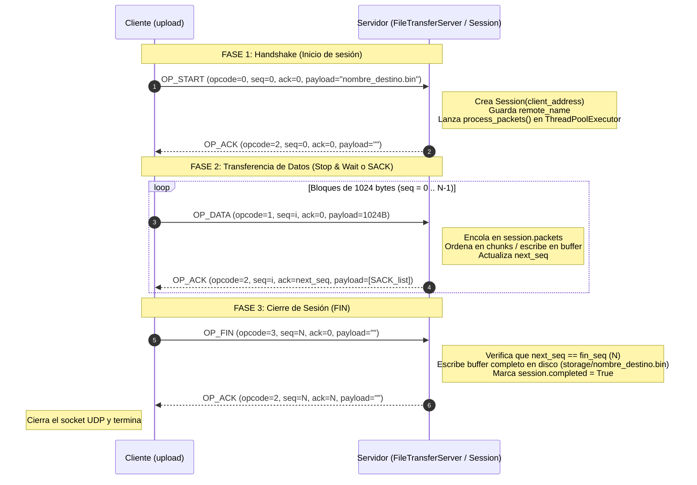
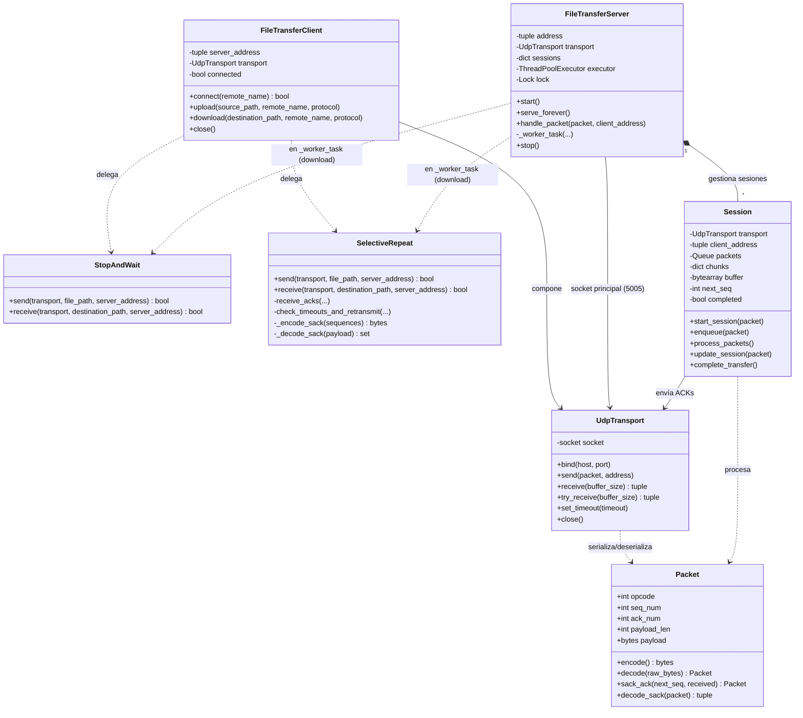

# Preguntas y Respuestas para la Defensa del TP1

Este documento responde en detalle las preguntas típicas de la defensa oral, basadas tanto en los conceptos teóricos de la materia como en **cómo está implementado exactamente nuestro código en `../TP1/src/lib/`**.

---

## 1. ¿Es necesario tener tanto `seq_num` como `ack_num` en el header de nuestro protocolo?

### Respuesta corta
**No es estrictamente necesario tener ambos en todos los paquetes** si la transferencia de datos es **unidireccional** (sin *piggybacking*), pero en nuestra implementación los incluimos en un header fijo de **11 bytes** (`opcode` 1B + `seq_num` 4B + `ack_num` 4B + `payload_len` 2B) por simplicidad de diseño y porque en **SACK** aprovechamos ambos campos en los paquetes `OP_ACK`.

### Explicación según nuestra implementación ([`protocol.py`](file:///home/rbarcala/MEGA/Redes/TP1/src/lib/protocol.py) y [`session.py`](file:///home/rbarcala/MEGA/Redes/TP1/src/lib/session.py))
- **En paquetes de datos (`OP_DATA`, `OP_START`, `OP_FIN`)**:
  - Como no hacemos *piggybacking* (el emisor solo envía datos y el receptor solo responde ACKs), el campo `ack_num` en un paquete `OP_DATA` es redundante (en `sack.py` se envía siempre en `0`). Solo se necesita `seq_num` para identificar qué bloque se está enviando.
- **En paquetes de confirmación (`OP_ACK`)**:
  - En **Stop & Wait** ([`stop_and_wait.py`](file:///home/rbarcala/MEGA/Redes/TP1/src/lib/stop_and_wait.py)): alcanza con un solo número (confirmar el paquete recibido).
  - En **Selective Repeat / SACK** ([`session.py`](file:///home/rbarcala/MEGA/Redes/TP1/src/lib/session.py#L37-L42) y [`sack.py`](file:///home/rbarcala/MEGA/Redes/TP1/src/lib/sack.py#L222-L224)): el receptor envía en el `OP_ACK`:
    - `seq_num`: el número de secuencia del paquete puntual que acaba de llegar y disparó este ACK.
    - `ack_num`: el **ACK acumulativo** (`expected_seq` / `self.next_seq`), es decir, el próximo número de secuencia en orden que el receptor está esperando (confirmando implícitamente todos los anteriores `< ack_num`).
    - `payload`: la lista de secuencias recibidas fuera de orden (bloques SACK de 4 bytes cada uno).
  - Incluso en SACK, al tener el ACK acumulativo + la lista SACK en el payload, un único campo de 4 bytes en el header alcanzaría si unificáramos el uso del campo entre `OP_DATA` (como `seq_num`) y `OP_ACK` (como `ack_num` acumulativo). Se dejaron ambos campos separados para tener una estructura de header simétrica similar a TCP.

---

## 2. ¿Qué representan los bytes del `seq_num` en UDP, en TCP y en nuestro protocolo?

1. **En UDP (capa de transporte)**:
   - **UDP NO tiene `seq_num`**. El header UDP solo tiene 8 bytes: Puerto Origen (2B), Puerto Destino (2B), Longitud (2B) y Checksum (2B). No garantiza entrega ni orden.
2. **En TCP (capa de transporte)**:
   - El `Sequence Number` de TCP (4 bytes / 32 bits) **cuenta bytes del flujo de datos**, no paquetes. Representa el **número de orden del primer byte de datos** contenido en ese segmento TCP (partiendo de un *Initial Sequence Number* aleatorio negociado en el *3-way handshake*).
   - De igual forma, el `ACK Number` en TCP indica el **próximo byte esperado** (es acumulativo).
3. **En nuestro protocolo sobre UDP ([`protocol.py`](file:///home/rbarcala/MEGA/Redes/TP1/src/lib/protocol.py))**:
   - Nuestro `seq_num` (4 bytes, `uint32` big-endian) **no cuenta bytes, sino número de paquete / bloque (*chunk*)**.
   - Arranca en `0` para el primer bloque de datos de `1024 bytes` (`CHUNK_SIZE = 1024`), `1` para el segundo bloque, y así sucesivamente hasta `N-1`, usando el número `N` para el paquete `OP_FIN`.

---

## 3. ¿Cómo implementamos el timeout?

Tenemos **dos mecanismos distintos** según el protocolo elegido:

### A. En Stop & Wait ([`transport.py`](file:///home/rbarcala/MEGA/Redes/TP1/src/lib/transport.py) y [`stop_and_wait.py`](file:///home/rbarcala/MEGA/Redes/TP1/src/lib/stop_and_wait.py))
- Se implementa directamente con el **timeout del socket UDP de Python**: `self.socket.settimeout(timeout)` (por defecto `1.0` segundo al crear [`FileTransferClient`](file:///home/rbarcala/MEGA/Redes/TP1/src/lib/file_transfer_client.py#L11), y `0.5s` en el cierre de `FIN`).
- En [`UdpTransport.try_receive()`](file:///home/rbarcala/MEGA/Redes/TP1/src/lib/transport.py#L23-L29), se hace `self.socket.recvfrom(buffer_size)` dentro de un bloque `try / except socket.timeout`:
  - Si el timer del socket expira antes de que llegue el datagrama, captura `socket.timeout` y devuelve `(None, None)`.
  - En `StopAndWait.send()`, si `transport.receive()` devuelve `None` o no es el ACK esperado, el bucle `for _ in range(MAX_TRIES)` (máximo 5 intentos) **retransmite el paquete**.

### B. En Selective Repeat / SACK ([`sack.py`](file:///home/rbarcala/MEGA/Redes/TP1/src/lib/sack.py))
Como hay hasta 32 paquetes en vuelo al mismo tiempo, no podemos bloquear el socket esperando un único paquete durante 1 segundo:
1. **Timers lógicos por paquete (`time_sent`)**:
   - Cuando se envía cada paquete en la ventana ([`sack.py`](file:///home/rbarcala/MEGA/Redes/TP1/src/lib/sack.py#L166-L171)), se guarda en el diccionario `packets[next_seq]` su timestamp de envío: `'time_sent': time.time()`, junto con `'sacked': False` y `'tries': 1`.
2. **Espera no bloqueante corta con `select.select` (`receive_acks`)**:
   - En [`SelectiveRepeat.receive_with_timeout()`](file:///home/rbarcala/MEGA/Redes/TP1/src/lib/sack.py#L41-L69), se usa `select.select([transport.socket], [], [], remaining)` con un `ACK_POLL_TIMEOUT = 0.02` (20 ms) para leer todos los ACKs que hayan llegado al buffer de red sin quedarse bloqueado si no llegan más.
3. **Verificación de RTO y retransmisión selectiva (`check_timeouts_and_retransmit`)**:
   - En cada iteración del bucle principal ([`sack.py`](file:///home/rbarcala/MEGA/Redes/TP1/src/lib/sack.py#L101-L118)), se recorren los paquetes pendientes en `packets`.
   - Para cada paquete con `sacked == False`, se calcula `time_since_sent = current_time - packet_info['time_sent']`.
   - Si `time_since_sent >= RTO` (`INITIAL_RTO = 0.5` segundos) y `tries < MAX_TRIES` (12 intentos), **se retransmite únicamente ese paquete**, se actualiza su `time_sent = current_time` y se incrementa `tries += 1`.

### C. En las sesiones del Servidor para Uploads ([`session.py`](file:///home/rbarcala/MEGA/Redes/TP1/src/lib/session.py))
- El hilo principal del servidor recibe todos los datagramas y los encola en `session.packets` (una `queue.Queue` por cliente).
- El worker thread de la sesión hace `self.packets.get(timeout=TIMEOUT)` con `TIMEOUT = 5` segundos ([`session.py`](file:///home/rbarcala/MEGA/Redes/TP1/src/lib/session.py#L66)). Si un cliente desaparece por más de 5 segundos, salta la excepción `Empty` y la sesión se aborta y limpia.

---

## 4. ¿Cómo funciona la ventana de SACK (Selective Repeat)?

Está implementada en [`src/lib/sack.py`](file:///home/rbarcala/MEGA/Redes/TP1/src/lib/sack.py) (emisor y receptor de download) y [`src/lib/session.py`](file:///home/rbarcala/MEGA/Redes/TP1/src/lib/session.py) (receptor de upload en el servidor):

### Lado Emisor (`SelectiveRepeat.send`)
- **Tamaño de ventana**: `WINDOW_SIZE = 32` paquetes (cada paquete lleva hasta `CHUNK_SIZE = 1024` bytes $\rightarrow$ hasta 32 KB en vuelo).
- **Punteros de la ventana**:
  - `base_seq`: el número de secuencia más viejo que **todavía no fue confirmado**.
  - `next_seq`: el próximo número de secuencia a enviar.
- **Condición de envío**: mientras no se llegue al fin del archivo (`not eof`) y **`next_seq < base_seq + WINDOW_SIZE`**, el emisor lee bloques del archivo, los envía sin esperar y los registra en el diccionario `packets[next_seq]`.
- **Procesamiento de ACKs (`receive_acks`)**:
  - Cada paquete `OP_ACK` que vuelve del receptor trae dos informaciones clave:
    1. **`ack_packet.ack_num` (ACK acumulativo)**: indica que el receptor ya recibió en forma continua todos los paquetes anteriores a `ack_num`. Por lo tanto, el emisor **elimina de `packets` todos los `seq_num < cumulative_ack`** y desliza la base de la ventana: `base_seq = max(base_seq, cumulative_ack)`. Al avanzar `base_seq`, se habilita espacio para enviar nuevos paquetes.
    2. **`ack_packet.payload` (Lista SACK)**: es una secuencia de enteros de 4 bytes (`_decode_sack`) con los números de secuencia mayores a `base_seq` que el receptor ya recibió fuera de orden. El emisor marca esos paquetes en su diccionario con **`packets[seq_num]['sacked'] = True`**.
- **Retransmisión selectiva**:
  - Cuando vence el `RTO` (`0.5s`), `check_timeouts_and_retransmit` **ignora los paquetes que tienen `'sacked': True`** y solo retransmite aquellos paquetes dentro de la ventana cuyo timer venció y siguen sin confirmarse.

### Lado Receptor (`Session.update_session` y `SelectiveRepeat.receive`)
- Mantiene:
  - `expected_seq` (o `self.next_seq`): el próximo paquete esperado en orden.
  - `chunks`: un diccionario (`{seq_num: payload}`) que actúa como **buffer de recepción fuera de orden**.
- Cuando llega un `OP_DATA` con `packet.seq_num`:
  1. **Si `seq_num < expected_seq`**: es un duplicado viejo. No lo guarda, pero reenvía inmediatamente un `OP_ACK` con el `expected_seq` actual y la lista SACK actual.
  2. **Si `seq_num > expected_seq`**: llegó fuera de orden (se perdió alguno anterior). Lo guarda en el buffer `chunks[seq_num] = payload` (si no estaba ya) y envía un `OP_ACK` indicando que sigue esperando `expected_seq`, pero adjuntando en el payload todas las claves `sorted(chunks.keys())` codificadas en 4 bytes cada una (el bloque SACK).
  3. **Si `seq_num == expected_seq`**: era el paquete que faltaba para mantener el orden. Lo escribe en el archivo/buffer, incrementa `expected_seq += 1`, y ejecuta un bucle `while expected_seq in chunks:` que **vuelca en orden todos los paquetes consecutivos que ya habían llegado antes por SACK**, vaciándolos de `chunks` y deslizando `expected_seq` de golpe.

---

## 5. Uso de `ifconfig` / `ip -s link` antes y después de enviar un archivo

### ¿Por qué el docente pide correr `ifconfig` (o `ip -s link`) antes y después de la transferencia?
Para medir **a nivel de interfaz de red del sistema operativo** cuántos paquetes (`packets`) y cuántos bytes (`bytes`) se transmitieron (`TX`) y recibieron (`RX`) realmente por el cable virtual de Mininet (`h1-eth0`).

### ¿Cómo se lee `ifconfig` (o `ip -s link`) y qué se compara?
Si en la `xterm` de `h1` ejecutás `ifconfig` (o `ip -s link show h1-eth0`) antes y después de subir un archivo de **5 MB** ($5 \times 1024 \times 1024 = 5.242.880\text{ bytes}$):
1. **Cantidad de paquetes de datos ideales (sin pérdida)**:
   $$\frac{5.242.880\text{ bytes}}{1024\text{ bytes/paquete}} = 5120\text{ paquetes de datos} + 1\text{ START} + 1\text{ FIN} = 5122\text{ paquetes}$$
2. **Estimación teórica con 10% de pérdida en cada sentido ($p = 0.10$)**:
   - Como el enlace de ida pierde el 10% de los paquetes, cada paquete de datos necesita en promedio $\frac{1}{1 - p} = \frac{1}{0.9} \approx 1.111$ envíos.
   - Es decir, como mínimo esperamos transmitir por `TX`:
     $$\frac{5120}{0.90} \approx 5689\text{ paquetes de datos}$$
     lo que equivale a **~569 retransmisiones** como piso (más algunas retransmisiones extra cuando se pierden los ACKs en el sentido de vuelta con otro 10% de probabilidad y vencen los RTOs).
3. **Comparación con `TX packets` y `TX bytes` de `ifconfig` / `ip -s link`**:
   - Restás `TX packets (después) - TX packets (antes)`. Vas a ver un valor cercano a `~5750 - 6100` paquetes.
   - Restando los `5122` paquetes originales obtenés la cantidad de paquetes retransmitidos, y demostrás que es consistente con el 10% de pérdida configurado en Mininet.
   - En `TX bytes (después) - TX bytes (antes)` vas a ver que en lugar de enviarse solo `5.24 MB`, se enviaron alrededor de `~6.0 - 6.3 MB` por la red debido a:
     1. Los bytes de los paquetes retransmitidos (~10-15% extra).
     2. El overhead de encabezados de cada paquete: `14B (Ethernet) + 20B (IP) + 8B (UDP) + 11B (Protocolo TP1) = 53 bytes` de headers por cada paquete de `1024 bytes` de datos.

*(Nota: en nuestro script [`04_transferencia_pipelining.sh`](file:///home/rbarcala/MEGA/Redes/scripts_TP1/04_transferencia_pipelining.sh) ya se imprime la salida de `ip -s link` antes y después y se hace esta resta automáticamente, pero también podés tirar `ifconfig` a mano en la `xterm` si el profe te lo pide).*

---

## 6. ¿Cómo es el ciclo completo de paquetes de un `UPLOAD` de Cliente a Servidor?

El ciclo completo tiene **3 fases** y se puede seguir en [`src/upload`](file:///home/rbarcala/MEGA/Redes/TP1/src/upload), [`file_transfer_client.py`](file:///home/rbarcala/MEGA/Redes/TP1/src/lib/file_transfer_client.py), [`file_transfer_server.py`](file:///home/rbarcala/MEGA/Redes/TP1/src/lib/file_transfer_server.py) y [`session.py`](file:///home/rbarcala/MEGA/Redes/TP1/src/lib/session.py):



### Paso a paso detallado en el código:

1. **Fase 1 — Handshake (`OP_START`)**:
   - En [`src/upload`](file:///home/rbarcala/MEGA/Redes/TP1/src/upload#L53), el cliente llama a `cliente.connect(args.name)`.
   - `connect()` ([`file_transfer_client.py`](file:///home/rbarcala/MEGA/Redes/TP1/src/lib/file_transfer_client.py#L16-L60)) arma un paquete `OP_START` (`opcode = 0`, `seq = 0`, `ack = 0`) cuyo `payload` es el nombre con el que se guardará el archivo en el servidor (ej. `"destino.bin"`), y lo envía al puerto `5005` del servidor esperando el `OP_ACK` (reintentando hasta `MAX_TRIES` si se pierde).
   - El servidor lo recibe en su hilo principal (`serve_forever` $\rightarrow$ `handle_packet`), ve que es un `OP_START`, instancia un objeto [`Session`](file:///home/rbarcala/MEGA/Redes/TP1/src/lib/session.py) asociado a la tupla `(ip_cliente, puerto_efimero_cliente)`, guarda `client_session.remote_name = file_name`, responde inmediatamente el `OP_ACK` (`seq = 0, ack = 0`) en `start_session()`, y envía la tarea `client_session.process_packets` al `ThreadPoolExecutor(max_workers=10)`.

2. **Fase 2 — Envío de datos (`OP_DATA` $\leftrightarrow$ `OP_ACK`)**:
   - Una vez confirmado el handshake, [`src/upload`](file:///home/rbarcala/MEGA/Redes/TP1/src/upload#L56) llama a `cliente.upload(args.src, args.name, args.protocol)`.
   - Dependiendo de `-r sw` o `-r sack`, delega en `StopAndWait.send()` o `SelectiveRepeat.send()` usando **el mismo socket UDP** del cliente.
   - El cliente abre el archivo local en modo binario (`"rb"`), lo lee en fragmentos de `1024 bytes` (`CHUNK_SIZE`), y envía paquetes `OP_DATA` (`opcode = 1`) numerados desde `seq_num = 0` hasta `N - 1`.
   - En el servidor, cada vez que llega un paquete de ese `(ip_cliente, puerto_cliente)`, el hilo principal lo mete en la cola `self.sessions[client_address].enqueue(packet)`.
   - El hilo trabajador de esa `Session` lo saca de la cola en `process_packets()` $\rightarrow$ `update_session()`, guarda el fragmento en `self.chunks[seq_num]`, ensambla en orden en `self.buffer` a medida que `self.next_seq` está disponible, y envía de vuelta un `OP_ACK` (`opcode = 2`) con `seq = packet.seq_num`, `ack = self.next_seq` y la lista SACK de bloques fuera de orden en el payload.

3. **Fase 3 — Fin de transferencia (`OP_FIN` $\leftrightarrow$ `OP_ACK`)**:
   - Cuando el cliente termina de leer el archivo (y, en el caso de SACK, cuando todos los paquetes de datos en la ventana fueron confirmados y `packets` quedó vacío), envía un paquete `OP_FIN` (`opcode = 3`) con `seq_num = N` (donde `N` es la cantidad total de bloques de datos enviados) y payload vacío.
   - Si el `OP_FIN` o su `OP_ACK` se pierden, el cliente reintenta enviar el `OP_FIN` hasta `MAX_TRIES`.
   - Cuando la `Session` del servidor recibe el `OP_FIN` (y ya tiene todos los bloques desde `0` hasta `N - 1`, es decir `self.next_seq == self.fin_seq`), responde el `OP_ACK` del `FIN` y llama a [`complete_transfer()`](file:///home/rbarcala/MEGA/Redes/TP1/src/lib/session.py#L124-L140), que vuelca `self.buffer` al archivo final en disco (`storage/<remote_name>`) y marca `self.completed = True`, terminando el hilo de esa sesión.
   - El cliente recibe el `OP_ACK` del `OP_FIN`, ejecuta el bloque `finally: cliente.close()` cerrando el socket UDP y finaliza el programa.

*(Nota adicional por si te preguntan la diferencia con **DOWNLOAD**: en un `UPLOAD` todos los paquetes viajan por el puerto `5005` del servidor encolados en `Session.packets`, mientras que en un `DOWNLOAD` el cliente envía `OP_START` con payload `"DOWNLOAD:sack:archivo.bin"` al puerto `5005` y el servidor lanza `_worker_task` en el `ThreadPoolExecutor` creando un `sender_transport = UdpTransport()` nuevo con su propio socket efímero para transmitirle los `OP_DATA` al cliente sin competir por lecturas del socket `5005`).*


---

## 7. ¿Cómo funciona la concurrencia en el TP?

La concurrencia está implementada en el servidor ([`file_transfer_server.py`](file:///home/rbarcala/MEGA/Redes/TP1/src/lib/file_transfer_server.py) y [`session.py`](file:///home/rbarcala/MEGA/Redes/TP1/src/lib/session.py)) combinando un **hilo receptor central (demultiplexor)**, un **pool de hilos trabajadores (`ThreadPoolExecutor`)** y dos estrategias diferenciadas según la operación sea **UPLOAD** o **DOWNLOAD**:

### 1. Identificación de clientes y tabla de sesiones (`self.sessions`)
- Como UDP no es orientado a conexión, todos los clientes envían su primer paquete (`OP_START`) al mismo socket del servidor (`10.0.0.5:5005`).
- El servidor identifica unívocamente a cada flujo cliente por su tupla **`client_address = (ip_cliente, puerto_efimero_UDP)`** y lo registra en el diccionario `self.sessions[client_address] = client_session`.
- El acceso a `self.sessions` está protegido por un **`threading.Lock()` (`self.lock`)** ([`file_transfer_server.py`](file:///home/rbarcala/MEGA/Redes/TP1/src/lib/file_transfer_server.py#L19)) para evitar condiciones de carrera (*race conditions*) cuando un hilo principal agrega sesiones y un hilo trabajador las elimina al abortar (`_cleanup_session`).

### 2. Concurrencia en UPLOADs: Patrón Productor-Consumidor con `queue.Queue`
- En un **UPLOAD**, todos los paquetes `OP_DATA` de todos los clientes llegan al único socket del servidor en el puerto `5005`.
- Si varios hilos hicieran `recvfrom()` directamente sobre el mismo socket `5005`, se robarían los paquetes entre sí.
- **Solución implementada**:
  1. **Un único hilo productor (`serve_forever`)** lee del socket `5005` con `self.transport.receive()`.
  2. Busca `client_address` en `self.sessions` y **encola el paquete** en la cola privada de ese cliente: `self.sessions[client_address].enqueue(packet)` (que internamente usa `queue.Queue()`, la cual es *thread-safe*).
  3. **Un hilo consumidor por sesión (`Session.process_packets`)** corre en paralelo dentro del `ThreadPoolExecutor(max_workers=10)`, sacando paquetes de su propia cola (`self.packets.get(timeout=5)`), ordenándolos en su propio diccionario `self.chunks`, ensamblando en su `self.buffer` y enviando los `OP_ACK` de vuelta.

### 3. Concurrencia en DOWNLOADs: Socket efímero dedicado por transferencia (`_worker_task`)
- En un **DOWNLOAD**, el servidor pasa a ser el **emisor** (`StopAndWait.send` o `SelectiveRepeat.send`), por lo que necesita hacer `receive()` constantemente para leer los `OP_ACK` que le devuelve el cliente.
- Si el hilo de download leyera del socket principal `5005`, competiría con `serve_forever()` y consumiría por error paquetes de otros clientes.
- **Solución implementada** ([`file_transfer_server.py`](file:///home/rbarcala/MEGA/Redes/TP1/src/lib/file_transfer_server.py#L147-L158)):
  - El servidor responde el `OP_ACK` del handshake inicial por el puerto `5005` y lanza `_worker_task` en el `ThreadPoolExecutor`.
  - `_worker_task` **crea una nueva instancia `sender_transport = UdpTransport(timeout=1.0)`**, a la cual el sistema operativo le asigna un **puerto UDP efímero exclusivo** para esa descarga.
  - Del lado del cliente ([`stop_and_wait.py`](file:///home/rbarcala/MEGA/Redes/TP1/src/lib/stop_and_wait.py#L108-L111) y [`sack.py`](file:///home/rbarcala/MEGA/Redes/TP1/src/lib/sack.py#L65)), al recibir el primer `OP_DATA`, el cliente valida que la IP origen sea la del servidor (`address[0] == expected_address[0]`) y **actualiza `server_address = address`** al nuevo puerto efímero del hilo trabajador. A partir de ahí, todo el intercambio `OP_DATA <-> OP_ACK` de ese download ocurre por ese socket dedicado, 100% aislado del resto de los clientes.

---

## 8. ¿Cómo son ambos protocolos y en qué se diferencian?

Ambos protocolos implementan **transferencia confiable sobre UDP** usando el mismo formato de paquete de 11 bytes de header ([`protocol.py`](file:///home/rbarcala/MEGA/Redes/TP1/src/lib/protocol.py)), el mismo tamaño de bloque (`CHUNK_SIZE = 1024` bytes) y las mismas 3 fases (`OP_START`, `OP_DATA`, `OP_FIN`), pero difieren radicalmente en cómo manejan el envío y la recuperación ante pérdidas:

| Característica | Stop & Wait (`sw` - [`stop_and_wait.py`](file:///home/rbarcala/MEGA/Redes/TP1/src/lib/stop_and_wait.py)) | Selective Repeat / SACK (`sack` - [`sack.py`](file:///home/rbarcala/MEGA/Redes/TP1/src/lib/sack.py)) |
| :--- | :--- | :--- |
| **Pipelining / Ventana** | **Sin pipelining** (ventana efectiva = 1 paquete). No envía el paquete $i+1$ hasta recibir el `OP_ACK` del paquete $i$. | **Con pipelining** (`WINDOW_SIZE = 32` paquetes = 32 KB en vuelo sin esperar confirmación). |
| **Uso del canal (Throughput)** | Muy bajo cuando hay RTT alto: por cada paquete de 1 KB espera al menos 1 RTT (40 ms). Para 5 MB (5120 paquetes) tardaría $> 200$ segundos solo en tiempo de propagación. | Alto aprovechamiento del enlace: envía ráfagas de hasta 32 paquetes por RTT, completando los 5 MB con 10% de pérdida en pocos segundos ($< 2$ min). |
| **Tipo de ACK** | **Individual**: el `OP_ACK` confirma únicamente el `seq_num` recién recibido (`ack_num == seq_num`, payload vacío). | **Acumulativo + Selectivo (SACK)**: `ack_num` indica el próximo `seq` en orden esperado (confirmando todos los `< ack_num`) y el `payload` lista los `seq` mayores ya recibidos fuera de orden. |
| **Recepción fuera de orden** | No puede ocurrir que avance la secuencia sin confirmar el anterior; si llega un duplicado viejo (`seq < expected_seq`), solo reenvía su ACK. | **Buffer de recepción (`chunks`)**: si se pierde el paquete 5, el receptor guarda en memoria los paquetes $6, 7, \dots, 36$ y avisa por SACK que ya los tiene. Cuando llega el 5, entrega del 5 al 36 juntos. |
| **Manejo de Timeout** | Bloqueante en el socket (`socket.settimeout(1.0)`). | No bloqueante / polling corto con `select.select` (`20 ms`) + timestamp individual `'time_sent'` por paquete (`RTO = 0.5s`). |
| **Retransmisión** | Si vence el timeout (o se pierde el ACK), retransmite el único paquete actual (hasta `MAX_TRIES = 5`). | **Selectiva**: al vencer el `RTO` de un paquete, solo se retransmite si `'sacked' == False` (hasta `MAX_TRIES = 12`), evitando reenviar paquetes que ya llegaron. |

---

## 9. ¿Qué decisiones de arquitectura y diseño tomaron, y por qué?

1. **Encapsulamiento de la red en `UdpTransport` ([`transport.py`](file:///home/rbarcala/MEGA/Redes/TP1/src/lib/transport.py))**:
   - **Qué hicimos**: Separamos las llamadas de bajo nivel de `socket` (`sendto`, `recvfrom`, `bind`, `settimeout`) y la serialización (`Packet.encode()` / `Packet.decode()`) en la clase `UdpTransport`.
   - **Por qué**: Permitió desacoplar los algoritmos de los protocolos (`StopAndWait` y `SelectiveRepeat`) del socket real. Gracias a esto pudimos inyectar transportes simulados (*mocks*) en los tests unitarios de `tests/` sin necesitar abrir puertos reales ni levantar Mininet para testear pérdidas de paquetes.

2. **Protocolo binario propio de cabecera fija de 11 bytes ([`protocol.py`](file:///home/rbarcala/MEGA/Redes/TP1/src/lib/protocol.py))**:
   - **Qué hicimos**: Diseñamos un header compacto en *big-endian* de 11 bytes: `Opcode (1B) + Seq (4B) + Ack (4B) + Payload_Len (2B)`.
   - **Por qué**:
     - Tiene muy bajo overhead (11 bytes frente a 1024 bytes de datos $\approx 1\%$).
     - `Seq` y `Ack` de 4 bytes (`uint32`) permiten hasta $4 \times 10^9$ bloques de 1 KB ($\approx 4\text{ TB}$), evitando cualquier problema de *wrap-around* de números de secuencia en archivos grandes.
     - El campo `Payload_Len` (2 bytes) permite validar en `Packet.decode()` que el datagrama UDP no haya llegado truncado y permite transportar la lista variable de números de secuencia SACK en los paquetes `OP_ACK`.
     - Además, facilitó escribir el disector en Lua para Wireshark ([`mi_plugin.lua`](file:///home/rbarcala/MEGA/Redes/TP1/src/lib/mi_plugin.lua)) leyendo posiciones fijas del buffer.

3. **Tamaño de bloque `CHUNK_SIZE = 1024` bytes**:
   - **Por qué**: El MTU estándar de Ethernet es de **1500 bytes**. Con `1024 bytes` de payload + `11 bytes` de header propio + `8 bytes` UDP + `20 bytes` IP = **1063 bytes**, nos mantenemos holgadamente por debajo del MTU de 1500 bytes (incluso si el ACK llevara 32 bloques SACK de 4 bytes = 128 bytes), **evitando por completo la fragmentación IP** (que multiplicaría la probabilidad de pérdida de paquetes en enlaces ruidosos).

4. **Arquitectura híbrida en el Servidor (Cola por sesión para UPLOAD + Socket efímero para DOWNLOAD)**:
   - **Por qué**: En UDP todos los clientes contactan inicialmente al puerto `5005`. Para **UPLOAD**, centralizar el `recvfrom()` en el hilo principal y despachar a colas `queue.Queue` por sesión (`Session`) evita que múltiples hilos bloqueen o compitan sobre el mismo socket `5005`. En cambio, para **DOWNLOAD**, abrir un `UdpTransport` nuevo con un puerto efímero dentro del worker thread permite reutilizar exactamente el mismo método estático `StopAndWait.send()` y `SelectiveRepeat.send()` que usa el cliente en el upload, sin duplicar código de envío y sin interferir con el socket principal del servidor.

5. **Recepción unificada en el Servidor (`Session` soporta ambos protocolos transparentemente)**:
   - **Qué hicimos**: En [`session.py`](file:///home/rbarcala/MEGA/Redes/TP1/src/lib/session.py), cuando un cliente hace un UPLOAD, el servidor usa siempre la misma lógica de `Session.update_session()` tanto si el cliente transmite con Stop & Wait como con SACK.
   - **Por qué**: Un receptor Selective Repeat que envía ACKs con `seq_num` confirmado, `ack_num` acumulativo (`self.next_seq`) y payload SACK es **totalmente retrocompatible** con un emisor Stop & Wait (ya que cuando los paquetes llegan en orden de a uno, `chunks` está vacío, el payload SACK va vacío y `seq_num` coincide con el paquete confirmado). Esto simplificó el servidor sin necesitar dos clases de sesión distintas para Upload.

6. **Período de gracia en el cierre (`FIN_GRACE_PERIOD` / espera post-FIN en el receptor)**:
   - **Qué hicimos**: Tanto en `StopAndWait.receive()` ([`stop_and_wait.py`](file:///home/rbarcala/MEGA/Redes/TP1/src/lib/stop_and_wait.py#L136-L148)) como en `SelectiveRepeat.retry_reply_fin_ack()` ([`sack.py`](file:///home/rbarcala/MEGA/Redes/TP1/src/lib/sack.py#L185-L194)), después de recibir el `OP_FIN` y mandar su `OP_ACK`, el receptor no cierra inmediatamente sino que escucha brevemente por si llega un `OP_FIN` retransmitido.
   - **Por qué**: Es el equivalente al estado **`TIME_WAIT` de TCP**. Con 10% de pérdida de paquetes, existe un 10% de probabilidad de que el último `OP_ACK` del `OP_FIN` se pierda en la red. Si el receptor cerrara el socket enseguida, el emisor reintentaría enviar el `OP_FIN` hasta agotar `MAX_TRIES` y daría la transferencia por fallida aunque el archivo ya se hubiera escrito completo en disco.

---

## 10. ¿Qué hace su extensión de Lua, cómo lo hace, y por qué la diseñaron así?

Nuestra extensión es un **disector de Wireshark escrito en Lua** ([`../TP1/src/lib/mi_plugin.lua`](file:///home/rbarcala/MEGA/Redes/TP1/src/lib/mi_plugin.lua)) que decodifica y muestra en vivo el tráfico de nuestro protocolo sobre el puerto UDP `5005`.

---

### A. ¿Qué hace la extensión?
1. **Decodifica el encabezado de 11 bytes**:
   - `Opcode` (1 byte): traduce numéricamente `0 -> START`, `1 -> DATA`, `2 -> ACK`, `3 -> FIN`, `4 -> ERROR`.
   - `Sequence Number` (4 bytes, `uint32`).
   - `Acknowledgment Number` (4 bytes, `uint32`).
   - `Payload Length` (2 bytes, `uint16`).
2. **Distingue e identifica automáticamente la variante del protocolo**: muestra en la columna de protocolo de Wireshark si el flujo es **`STOPWAIT`** o **`SACK`**.
3. **Desglosa la lista SACK**: cuando un `OP_ACK` trae secuencias fuera de orden en su payload (múltiplos de 4 bytes), crea un subárbol en Wireshark (`Lista SACK: X paquete(s) recibido(s) fuera de orden`) e individualiza cada número de secuencia recibido.
4. **Formatea la columna de Información (`Info`)**: resume en una sola línea legible el tipo de paquete y sus parámetros: `DATA  Seq=12  Ack=0  Len=1024` o `ACK  Seq=15  Ack=12  Len=8  SACK=[14,15]`.
5. **Muestra advertencias diagnósticas (*Expert Info*)**: resalta en rojo/amarillo si llega un opcode inválido o si el tamaño declarado en `payload_len` no coincide con los bytes reales del datagrama UDP.

---

### B. ¿Cómo lo hace técnicamente?
1. **Registro sobre UDP 5005**:
   - Se crea el protocolo con `sw = Proto("stopwait", "Protocolo Stop and Wait / SACK")` y al final del script se asocia al puerto con:
     ```lua
     local udp_table = DissectorTable.get("udp.port")
     udp_table:add(5005, sw)
     ```
2. **Identificación de flujos bidireccionales (`flow_key`)**:
   - Para relacionar paquetes en ambos sentidos (cliente $\leftrightarrow$ servidor), arma una clave normalizada ordenando las tuplas `(IP:puerto)`:
     ```lua
     local a = tostring(pinfo.src) .. ":" .. tostring(pinfo.src_port)
     local b = tostring(pinfo.dst) .. ":" .. tostring(pinfo.dst_port)
     local key = (a < b) and (a .. "|" .. b) or (b .. "|" .. a)
     ```
3. **Detección automática de variante (`update_evidence`)**:
   - Como no agregamos un byte extra en el header para indicar "soy Stop & Wait" o "soy SACK", el disector detecta la variante observando el **comportamiento del flujo**:
     - **Regla 1**: si ve un paquete `OP_ACK` con `payload_len > 0` múltiplo de 4 bytes (la lista SACK), marca el flujo como `SACK`.
     - **Regla 2**: si ve **dos paquetes `OP_DATA` con números de secuencia distintos sin ningún ACK en el medio**, deduce que hay pipelining (ventana deslizante), por lo que clasifica el flujo como `SACK`.
     - Si nunca se cumplen estas dos condiciones, permanece como `STOPWAIT`.
   - Una vez que un flujo pasa a `SACK`, se memoriza en `flow_mode[key] = "SACK"` (y no se borra al hacer `Ctrl+R` / recargar captura para que los primeros paquetes ya queden clasificados correctamente).
4. **Lectura y parseo del buffer (`sw.dissector`)**:
   - Lee campos exactos con `buffer(offset, length):uint()`.
   - Para paquetes `START` o `ERROR`, decodifica el payload como texto legible (el nombre del archivo o el mensaje de error).
   - Para paquetes `ACK` en SACK, recorre de a 4 bytes (`buffer:range(i * 4, 4)`) y parsea cada secuencia fuera de orden.

---

### C. ¿Por qué lo diseñamos así?
1. **Inspección visual inmediata en la demo**:
   - Sin el plugin, Wireshark solo muestra paquetes UDP con bytes hexadecimales opacos. Con el plugin, tanto el docente como nosotros podemos ver a simple vista las retransmisiones, la ventana en vuelo y los bloques SACK confirmados sin tener que interpretar bytes a mano.
2. **Cero overhead en el protocolo (detección por inferencia)**:
   - En lugar de gastar bytes valiosos del header de 11 bytes para indicar qué protocolo es, dejamos que el analizador de red deduzca la variante analizando las ráfagas y los payloads SACK.
3. **Filtros de visualización nativos de Wireshark**:
   - Al definir `ProtoField` para cada campo, nos permite filtrar en la barra de búsqueda de Wireshark con expresiones simples durante la evaluación:
     - `stopwait.opcode == 1` (ver solo paquetes DATA).
     - `stopwait.variant == "SACK"` (ver solo tráfico SACK).
     - `stopwait.sack` (ver únicamente los ACKs que reportaron paquetes fuera de orden).
     - `stopwait.seq == 42` (ver la historia y retransmisiones del paquete 42).
     
---

## 11. ¿Qué hacen paso a paso en la extensión de Lua (con sintaxis y todo)?

El código completo está en [`../TP1/src/lib/mi_plugin.lua`](file:///home/rbarcala/MEGA/Redes/TP1/src/lib/mi_plugin.lua). A continuación se explica línea por línea cada bloque de la API de Lua para Wireshark:

### Paso 1: Constantes y definición del protocolo
```lua
local HEADER_SIZE = 11
local SACK_ENTRY_SIZE = 4   -- cada elemento de la lista SACK es un seq de 4 bytes

local OP_START, OP_DATA, OP_ACK, OP_FIN, OP_ERROR = 0, 1, 2, 3, 4

local sw = Proto("stopwait", "Protocolo Stop and Wait / SACK")

local opcode_names = {
    [OP_START] = "START",
    [OP_DATA]  = "DATA",
    [OP_ACK]   = "ACK",
    [OP_FIN]   = "FIN",
    [OP_ERROR] = "ERROR",
}
```
- **`Proto(nombre, descripcion)`**: es la función de la API de Wireshark que crea un nuevo protocolo. `stopwait` es el nombre interno que se usa para los filtros de visualización (ej: `stopwait.opcode == 1`).
- **`opcode_names`**: es una tabla (diccionario de Lua) que mapea el valor entero del opcode a su nombre legible.

---

### Paso 2: Declaración de los campos (`ProtoField`)
```lua
local f_variant = ProtoField.string("stopwait.variant", "Variante")
local f_opcode  = ProtoField.uint8("stopwait.opcode", "Opcode", base.DEC, opcode_names)
local f_seq     = ProtoField.uint32("stopwait.seq", "Sequence Number", base.DEC)
local f_ack     = ProtoField.uint32("stopwait.ack", "Acknowledgment Number", base.DEC)
local f_len     = ProtoField.uint16("stopwait.payload_len", "Payload Length", base.DEC)
local f_payload = ProtoField.bytes("stopwait.payload", "Payload")
local f_text    = ProtoField.string("stopwait.payload_text", "Payload (texto)")
local f_sack    = ProtoField.uint32("stopwait.sack", "Seq recibido fuera de orden", base.DEC)

sw.fields = { f_variant, f_opcode, f_seq, f_ack, f_len, f_payload, f_text, f_sack }
```
- **`ProtoField.<tipo>(filtro, etiqueta, [base], [tabla_nombres])`**: define cómo Wireshark interpreta cada campo en el árbol de disección y qué nombre de filtro le asigna:
  - `uint8`, `uint16`, `uint32`: leen enteros sin signo de 1, 2 o 4 bytes. `base.DEC` indica que se muestran en base decimal.
  - Al pasarle `opcode_names` al `uint8`, Wireshark muestra automáticamente `DATA (1)` en vez de un simple `1`.
- **`sw.fields = { ... }`**: registra formalmente todos los campos dentro del protocolo.

---

### Paso 3: Alertas visuales (*Expert Info*)
```lua
local ef_bad_opcode = ProtoExpert.new("stopwait.bad_opcode", "Opcode invalido",
    expert.group.MALFORMED, expert.severity.WARN)
local ef_bad_len = ProtoExpert.new("stopwait.bad_length",
    "La longitud del payload no coincide con los bytes recibidos",
    expert.group.MALFORMED, expert.severity.ERROR)

sw.experts = { ef_bad_opcode, ef_bad_len }
```
- **`ProtoExpert.new(...)`**: genera advertencias coloreadas en Wireshark (panel de información experta) si se captura un paquete con opcode desconocido o si el payload fue truncado.

---

### Paso 4: Seguimiento del flujo y detección automática de variante
```lua
local flow_mode = {}   -- flow_mode[flujo] = "SACK"
local pending = {}     -- pending[flujo] = seq del ultimo DATA/FIN todavia sin ACK

function sw.init()
    pending = {}
end

local function flow_key(pinfo)
    local a = tostring(pinfo.src) .. ":" .. tostring(pinfo.src_port)
    local b = tostring(pinfo.dst) .. ":" .. tostring(pinfo.dst_port)
    if a < b then
        return a .. "|" .. b
    end
    return b .. "|" .. a
end

local function update_evidence(key, opcode, seq, payload_len)
    if flow_mode[key] == "SACK" then
        return
    end

    if opcode == OP_ACK then
        if payload_len > 0 and payload_len % SACK_ENTRY_SIZE == 0 then
            flow_mode[key] = "SACK"
        end
        pending[key] = nil
    elseif opcode == OP_DATA or opcode == OP_FIN then
        if pending[key] ~= nil and pending[key] ~= seq then
            flow_mode[key] = "SACK"
        end
        pending[key] = seq
    end
end
```
- **`sw.init()`**: Wireshark la llama al cargar o reiniciar una captura. Vaciamos `pending` pero conservamos `flow_mode` para que al recargar (`Ctrl+R`) los primeros paquetes mantengan su variante deducida.
- **`flow_key(pinfo)`**: `pinfo` es el objeto *Packet Information* provisto por Wireshark (`pinfo.src`, `pinfo.src_port`, etc.). Al ordenar alfabéticamente `a` y `b`, los paquetes de ida y vuelta comparten exactamente la misma clave de flujo.
- **`update_evidence(...)`**:
  - Si un ACK trae payload múltiplo de 4 bytes -> es la lista SACK -> marca `SACK`.
  - Si ve un `DATA` o `FIN` con número de secuencia distinto al anterior sin que haya llegado un ACK en el medio -> hay múltiples paquetes en vuelo (pipelining) -> marca `SACK`.

---

### Paso 5: La función Dissector (`sw.dissector`)
```lua
function sw.dissector(buffer, pinfo, tree)
    local total = buffer:len()
    if total < HEADER_SIZE then
        return 0
    end
```
- **Parámetros obligatorios del dissector**:
  - `buffer`: un objeto `Tvb` (*Testy Virtual Buffer*) con los bytes crudos del payload UDP.
  - `pinfo`: metadatos del paquete (columnas, protocolo, IPs, puertos).
  - `tree`: la raíz del árbol visual de disección de Wireshark.
- Si `buffer:len() < 11`, retorna 0 indicando que no es un paquete válido de nuestro protocolo.

#### Parseo de los campos fijos del header:
```lua
    local opcode      = buffer(0, 1):uint()
    local seq         = buffer(1, 4):uint()
    local ack         = buffer(5, 4):uint()
    local payload_len = buffer(9, 2):uint()
```
- **Sintaxis `buffer(offset, length):uint()`**: es un slice del buffer llamado `TvbRange`. `buffer(0, 1):uint()` extrae 1 byte en offset 0 como entero sin signo; `buffer(1, 4):uint()` extrae 4 bytes como entero big-endian de 32 bits.

#### Deducción y actualización de la columna de protocolo:
```lua
    local key = flow_key(pinfo)
    if not pinfo.visited then
        update_evidence(key, opcode, seq, payload_len)
    end
    local variant = flow_mode[key] or "STOPWAIT"
    local is_sack = (variant == "SACK")

    pinfo.cols.protocol = variant
```
- `not pinfo.visited`: asegura que la evidencia solo se analice en la primera pasada de captura, evitando falsos positivos al hacer scroll en Wireshark.
- `pinfo.cols.protocol = variant`: cambia la columna "Protocol" de Wireshark de `UDP` a `STOPWAIT` o `SACK`.

#### Creación del árbol en la interfaz gráfica:
```lua
    local title = is_sack and "Protocolo SACK" or "Protocolo Stop and Wait"
    local subtree = tree:add(sw, buffer(), title)
    subtree:add(f_variant, buffer(0, 0), variant):set_generated()

    local op_item  = subtree:add(f_opcode, buffer(0, 1))
    local seq_item = subtree:add(f_seq, buffer(1, 4))
    local ack_item = subtree:add(f_ack, buffer(5, 4))
    local len_item = subtree:add(f_len, buffer(9, 2))
```
- **`tree:add(sw, buffer(), title)`**: crea la rama principal desplegable del protocolo.
- **`subtree:add(ProtoField, TvbRange)`**: asocia visualmente cada campo con los bytes resaltados en el panel hexadecimal inferior de Wireshark.
- **`:set_generated()`**: marca que el campo `variant` fue deducido por el disector y no leído directamente de los bytes del paquete.

#### Parseo dinámico del Payload (y de la lista SACK):
```lua
    local sack_list = {}
    local shown = math.min(payload_len, available)
    if shown > 0 then
        local payload_range = buffer(HEADER_SIZE, shown)

        if opcode == OP_ACK and shown % SACK_ENTRY_SIZE == 0 then
            local count = math.floor(shown / SACK_ENTRY_SIZE)
            local sack_tree = subtree:add(payload_range,
                string.format("Lista SACK: %d paquete(s) recibido(s) fuera de orden", count))
            for i = 0, count - 1 do
                local entry = payload_range:range(i * SACK_ENTRY_SIZE, SACK_ENTRY_SIZE)
                sack_tree:add(f_sack, entry)
                sack_list[#sack_list + 1] = entry:uint()
            end
        else
            subtree:add(f_payload, payload_range)
            if opcode == OP_START or opcode == OP_ERROR then
                subtree:add(f_text, payload_range)
            end
        end
    end
```
- Si es un `OP_ACK` con payload: divide la longitud por 4, crea una subrama `Lista SACK` y va agregando cada bloque de 4 bytes como un campo `f_sack`.
- Si es `OP_START` o `OP_ERROR`: agrega el campo `f_text` para que el nombre del archivo o el mensaje de error se lea directamente en ASCII en el árbol.

#### Formateo de la columna Info:
```lua
    local name = opcode_names[opcode] or ("OP?" .. opcode)
    local info = string.format("%s  Seq=%d  Ack=%d  Len=%d", name, seq, ack, payload_len)
    if #sack_list > 0 then
        info = info .. "  SACK=[" .. table.concat(sack_list, ",") .. "]"
    end
    pinfo.cols.info = info

    return total
end
```
- `pinfo.cols.info`: reemplaza la columna "Info" de Wireshark con un resumen legible del datagrama.
- `return total`: le indica a Wireshark la cantidad total de bytes consumidos de este paquete.

---

### Paso 6: Registro en la tabla de puertos UDP
```lua
local udp_table = DissectorTable.get("udp.port")
udp_table:add(5005, sw)
```
- Obtiene la tabla de disectores de puertos UDP (`DissectorTable.get("udp.port")`) y asocia nuestro protocolo `sw` al puerto `5005`. Así, todo tráfico UDP hacia o desde el puerto 5005 es despachado automáticamente a `sw.dissector`.

---

## 12. ¿Cómo funciona el header, es cabecera de qué? ¿Qué otras clases hay y cómo están relacionadas?

### A. ¿Cómo funciona el header y cabecera de qué es?
- **Es cabecera de Capa de Aplicación sobre Capa de Transporte (UDP)**.
- Nuestro protocolo viaja encapsulado como el **payload de los datagramas UDP**:
  ```text
  ┌─────────────────┬──────────────┬───────────────┬───────────────────────────────┐
  │ Ethernet Header │  IP Header   │  UDP Header   │        Payload de UDP         │
  │    (14 bytes)   │  (20 bytes)  │   (8 bytes)   │   (Nuestro Protocolo TP1)     │
  └─────────────────┴──────────────┴───────────────┴───────────────────────────────┘
                                                   │                               │
                                                   ▼                               ▼
                                                   ┌─────────────────┬─────────────┐
                                                   │ Header TP1 (11B)│ Payload TP1 │
                                                   └─────────────────┴─────────────┘
  ```
- **Estructura del Header (11 bytes en Big-Endian)**:
  1. **`opcode` (1 byte, `uint8`, offsets 0..0)**:
     - `0`: `OP_START` (inicio de sesión / handshake, payload lleva el nombre de archivo).
     - `1`: `OP_DATA` (fragmento del archivo, payload lleva hasta 1024 bytes).
     - `2`: `OP_ACK` (confirmación, payload vacío o lista SACK de secuencias fuera de orden).
     - `3`: `OP_FIN` (fin de archivo, payload vacío).
     - `4`: `OP_ERROR` (mensaje de error descriptivo en payload).
  2. **`seq_num` (4 bytes, `uint32`, offsets 1..4)**:
     - Identifica el número del paquete/bloque dentro de la transferencia (`0, 1, ..., N-1` y `N` para `FIN`).
  3. **`ack_num` (4 bytes, `uint32`, offsets 5..8)**:
     - En `OP_ACK`: representa el número de secuencia acumulativo esperado (`next_seq`). En paquetes de datos de SACK se completa en `0`.
  4. **`payload_len` (2 bytes, `uint16`, offsets 9..10)**:
     - Tamaño en bytes del payload que viene a continuación (`0` a `1024`, o múltiplos de 4 en lista SACK). Permite validar integridad y prevenir desbordes de buffer.

---

### B. ¿Qué clases componen el sistema y cómo están relacionadas?

El sistema está diseñado en capas modulares dentro de `../TP1/src/lib/`:



### Detalle de cada clase y su rol:

1. **[`Packet`](file:///home/rbarcala/MEGA/Redes/TP1/src/lib/protocol.py)**:
   - Modela la unidad de datos de protocolo (PDU).
   - Métodos principales:
     - `encode()`: serializa los campos al formato binario de 11 bytes + payload.
     - `decode()`: valida longitudes y opcodes, y reconstruye el objeto `Packet`.
     - `sack_ack()` / `decode_sack()`: codifica y decodifica la lista de números fuera de orden en el payload.

2. **[`UdpTransport`](file:///home/rbarcala/MEGA/Redes/TP1/src/lib/transport.py)**:
   - Capa de abstracción de red sobre el `socket.socket(AF_INET, SOCK_DGRAM)`.
   - Se encarga de llamar a `packet.encode()` antes de `sendto()`, y de llamar a `Packet.decode()` tras `recvfrom()`.
   - Maneja los timeouts de socket capturando `socket.timeout` y devolviendo `(None, None)`.

3. **[`StopAndWait`](file:///home/rbarcala/MEGA/Redes/TP1/src/lib/stop_and_wait.py)**:
   - Implementa la lógica sin pipelining (1 paquete a la vez).
   - Métodos estáticos puros: `send()` y `receive()`. Reciben un `UdpTransport`, la ruta del archivo y la dirección remota. No guardan estado propio en instancias, lo que facilita su reutilización tanto en cliente como en servidor.

4. **[`SelectiveRepeat`](file:///home/rbarcala/MEGA/Redes/TP1/src/lib/sack.py)**:
   - Implementa la lógica con pipelining (ventana de 32 paquetes y selective repeat).
   - Métodos estáticos principales: `send()` (maneja la ventana emisora `WINDOW_SIZE=32`, el polling de ACKs y el RTO) y `receive()` (maneja el buffer de recepción `chunks` fuera de orden y los ACKs con payloads SACK).

5. **[`FileTransferClient`](file:///home/rbarcala/MEGA/Redes/TP1/src/lib/file_transfer_client.py)**:
   - Fachada de cliente de alto nivel utilizada por los ejecutables de consola `upload` y `download`.
   - Compone un `UdpTransport`.
   - En `upload()`: hace el handshake con `connect()` y delega en `StopAndWait.send()` o `SelectiveRepeat.send()`.
   - En `download()`: manda `DOWNLOAD:protocol:remote_name` en el handshake y delega en `StopAndWait.receive()` o `SelectiveRepeat.receive()`.

6. **[`FileTransferServer`](file:///home/rbarcala/MEGA/Redes/TP1/src/lib/file_transfer_server.py)**:
   - El daemon servidor multihilo que escucha en `10.0.0.5:5005`.
   - Mantiene la tabla `self.sessions` protegida por `self.lock`.
   - En `serve_forever()` corre el bucle demultiplexor de paquetes UDP.
   - Administra el `ThreadPoolExecutor(max_workers=10)` donde corren las tareas de cada cliente.

7. **[`Session`](file:///home/rbarcala/MEGA/Redes/TP1/src/lib/session.py)**:
   - Representa el estado de una transferencia de subida (*UPLOAD*) de un cliente específico.
   - Tiene su propia cola interna de paquetes `self.packets = Queue()`.
   - Su método `process_packets()` corre en un hilo de trabajo separado, consumiendo de la cola, manteniendo el estado de ensamblado (`self.chunks` y `self.buffer`), respondiendo los `OP_ACK` y persistiendo el archivo final en disco al recibir el `OP_FIN`.
   - 
---

## 13. ¿La concurrencia se maneja de manera distinta en Upload y Download? ¿Por qué?

**Sí, se maneja de manera completamente distinta.** La razón de fondo es la **asimetría del rol del servidor** (en Upload el servidor es *receptor* de datos masivos, mientras que en Download es *emisor* de datos masivos) sumado al hecho de que **UDP no crea un socket nuevo por conexión** como sí hace TCP con `accept()`.

---

### A. ¿Cómo se maneja en UPLOAD? (Demultiplexación + Cola privada por cliente)

```text
Cliente 1 (OP_DATA) ──┐
Cliente 2 (OP_DATA) ──┼──> Socket 5005 ──> serve_forever() ──┬──> Queue 1 ──> Worker 1 (Session 1)
Cliente 3 (OP_DATA) ──┘   (Hilo Principal Demux)             ├──> Queue 2 ──> Worker 2 (Session 2)
                                                             └──> Queue 3 ──> Worker 3 (Session 3)
```

1. **Flujo de paquetes**:
   - Todos los clientes envían sus paquetes `OP_DATA` y `OP_FIN` dirigidos al **único socket conocido del servidor**: `10.0.0.5:5005`.
2. **Mecanismo de concurrencia**:
   - **Hilo Principal (`serve_forever`)**: es el **único** que hace `self.transport.receive()` sobre el socket `5005`. Al recibir un datagrama, mira la tupla `client_address = (IP, puerto)` y busca su sesión en el diccionario `self.sessions`.
   - **Colas `queue.Queue`**: el hilo principal no procesa los datos ni escribe a disco; simplemente hace `self.sessions[client_address].enqueue(packet)`.
   - **Hilos de trabajo (`Session.process_packets`)**: cada cliente tiene un hilo asignado en el `ThreadPoolExecutor(max_workers=10)` que consume exclusivamente de su cola local (`self.packets.get(timeout=5)`), arma el archivo en su buffer y responde los `OP_ACK` hacia ese cliente.
3. **¿Por qué se diseñó así para Upload?**:
   - Si cada hilo de sesión intentara hacer `recvfrom()` directamente sobre el socket `5005`, ocurriría una **condición de carrera destructiva**: el hilo de la Sesión A consumiría paquetes del Cliente B, mezclando o descartando chunks de archivos distintos. El hilo principal actúa como **demultiplexor centralizado**.

---

### B. ¿Cómo se maneja en DOWNLOAD? (Socket UDP Efímero dedicado por cliente)

```text
1. Handshake inicial:
   Cliente (DOWNLOAD) ──> Socket 5005 (Handshake OP_START) ──> Responde OP_ACK y lanza Worker

2. Transferencia de datos:
   Worker (Download 1) ──> Abre Socket Efímero A (ej. 45123) ──> OP_DATA / OP_ACK con Cliente 1
   Worker (Download 2) ──> Abre Socket Efímero B (ej. 45124) ──> OP_DATA / OP_ACK con Cliente 2
   (El socket 5005 queda 100% libre para recibir nuevos clientes)
```

1. **Flujo de paquetes**:
   - El cliente envía un `OP_START` con payload `"DOWNLOAD:<proto>:<archivo>"` al puerto `5005`.
   - El servidor responde el `OP_ACK` confirmando el inicio de la sesión por el puerto `5005`.
   - Inmediatamente después, el servidor despacha la función `_worker_task` al `ThreadPoolExecutor` ([`file_transfer_server.py`](file:///home/rbarcala/MEGA/Redes/TP1/src/lib/file_transfer_server.py#L147-L158)).
2. **Mecanismo de concurrencia**:
   - Adentro de `_worker_task`, el servidor **crea un socket UDP nuevo**:
     ```python
     sender_transport = UdpTransport(timeout=1.0)
     ```
   - El sistema operativo le asigna a este socket un **puerto efímero libre** (por ejemplo, `45123`).
   - El worker ejecuta `StopAndWait.send(sender_transport, ...)` o `SelectiveRepeat.send(sender_transport, ...)`.
   - El cliente, al recibir el primer `OP_DATA`, detecta que la IP es la del servidor pero el puerto cambió (`address != server_address`), y actualiza su destino a ese nuevo socket ([`sack.py`](file:///home/rbarcala/MEGA/Redes/TP1/src/lib/sack.py#L214)).
3. **¿Por qué se diseñó así para Download?**:
   - En una descarga, el servidor es el que **envía datos y espera ACKs**. Los métodos `StopAndWait.send` y `SelectiveRepeat.send` necesitan hacer `recvfrom()` bloqueante o con polling para leer los `OP_ACK` que envía el cliente.
   - Si el worker de download leyera del socket `5005`, competiría directamente con el hilo `serve_forever()` por los datagramas entrantes, "robándole" paquetes `OP_START` o `OP_DATA` de otros clientes que estén subiendo archivos.
   - Al crear un **socket efímero dedicado**, cada descarga tiene su propio canal bidireccional completamente aislado del socket `5005` y de los demás clientes.

---

### Cuadro comparativo resumen

| Criterio | En UPLOAD | En DOWNLOAD |
| :--- | :--- | :--- |
| **Rol del Servidor** | **Receptor** de datos (recibe `OP_DATA`, envía `OP_ACK`). | **Emisor** de datos (envía `OP_DATA`, recibe `OP_ACK`). |
| **Socket utilizado** | El socket principal compartido **`10.0.0.5:5005`**. | Un socket con **puerto efímero dedicado** por cada descarga (`sender_transport = UdpTransport()`). |
| **Paso de paquetes** | Hilo central `serve_forever()` encola en `Session.packets` (`Queue`). | Directo: el socket efímero solo recibe los ACKs de su respectivo cliente. |
| **Razón fundamental** | Evita que múltiples hilos compitan en `recvfrom()` sobre el puerto 5005 al recibir datos. | Evita que el bucle de envío/espera de ACKs interfiera con el socket de escucha 5005 del servidor. |


---

## 14. ¿Cuáles constantes hay en todo el TP y qué manejan? ¿Por qué decidieron esos valores?

A lo largo del código de `../TP1/src/lib/` definimos constantes clave para temporizadores, límites de reintentos, tamaños de buffers y control de concurrencia:

---

### 1. En [`protocol.py`](file:///home/rbarcala/MEGA/Redes/TP1/src/lib/protocol.py) — Formato de Cabecera y Opcodes

| Constante | Valor | Qué maneja | ¿Por qué decidieron ese valor? |
| :--- | :--- | :--- | :--- |
| `OP_START`, `OP_DATA`, `OP_ACK`, `OP_FIN`, `OP_ERROR` | `0, 1, 2, 3, 4` | Los 5 tipos de mensajes posibles del protocolo. | Permite diferenciar el propósito de cada paquete con un único byte sin ambigüedades. |
| `OPCODE_SIZE` | `1` (byte) | Tamaño del campo opcode. | 1 byte alcanza para definir hasta 256 tipos de operaciones (solo usamos 5). |
| `SEQ_SIZE` | `4` (bytes) | Tamaño del Sequence Number (`uint32`). | 4 bytes permiten contar hasta $2^{32}-1 pprox 4.29 	imes 10^9$ bloques. Con bloques de 1 KB, permite transferir archivos de hasta **~4 TB sin wrap-around** de secuencias. |
| `ACK_SIZE` | `4` (bytes) | Tamaño del Acknowledgment Number (`uint32`). | Idéntico a `SEQ_SIZE` para poder confirmar cualquier bloque de la secuencia en SACK y mantener el encabezado simétrico. |
| `LENGTH_SIZE` | `2` (bytes) | Tamaño del campo que indica la longitud del payload (`uint16`). | 2 bytes permiten especificar longitudes de hasta $65.535$ bytes, cubriendo holgadamente el payload máximo de datos (1024 B) o listas SACK. |
| `HEADER_SIZE` | `11` (bytes) | Longitud total fija del encabezado (`1 + 4 + 4 + 2`). | Es la suma exacta de los campos anteriores. Muy bajo overhead frente al bloque de datos (~1%). |

---

### 2. En [`sack.py`](file:///home/rbarcala/MEGA/Redes/TP1/src/lib/sack.py) — Selective Repeat / SACK

| Constante | Valor | Qué maneja | ¿Por qué decidieron ese valor? |
| :--- | :--- | :--- | :--- |
| `CHUNK_SIZE` | `1024` (bytes) | Cantidad de bytes del archivo que viajan en el payload de cada paquete `OP_DATA`. | **Evita la fragmentación IP**: Con `1024B (payload) + 11B (TP1) + 8B (UDP) + 20B (IP) = 1063 bytes`, queda holgadamente por debajo del **MTU estándar de Ethernet (1500 bytes)**. Si el datagrama superara 1500 bytes, IP fragmentaría el paquete en 2 fragmentos físicos, duplicando la tasa de pérdida en la red. |
| `WINDOW_SIZE` | `32` (paquetes) | Tamaño de la ventana deslizante emisora en Selective Repeat. | Determina el pipelining: permite hasta **32 KB en vuelo** ($32 	imes 1024$ B). Con un RTT de 40 ms, permite un throughput teórico de $pprox rac{32	ext{ KB}}{0.04	ext{ s}} = 800	ext{ KB/s}$, suficiente para transferir 5 MB en **~7 a 10 segundos** (cumpliendo sobradamente el requisito del enunciado de $< 2$ minutos). No se usó un valor más grande para no saturar colas ni generar congestión en Mininet. |
| `SACK_SIZE` | `4` (bytes) | Tamaño de cada número de secuencia dentro de la lista SACK del payload. | Mismo tamaño que `SEQ_SIZE` (un `uint32` en big-endian) para identificar unívocamente cada paquete recibido fuera de orden. |
| `INITIAL_RTO` | `0.5` (segundos) | *Retransmission Timeout* para reenviar paquetes no confirmados. | Con un RTT de red de **40 ms** (0.04 s), un RTO de **500 ms** es más de 12 veces el RTT normal. Esto previene **retransmisiones espurias o prematuras** causadas por jitter o demoras transitorias de procesamiento en Mininet, pero reacciona lo suficientemente rápido para recuperar pérdidas sin frenar la transferencia. |
| `MAX_TRIES` | `12` | Cantidad máxima de reintentos antes de abortar la transferencia. | Con una tasa de pérdida configurada de **10%** ($p = 0.10$), la probabilidad de que un paquete se pierda 12 veces consecutivas es extremadamente baja: $0.10^{12} = 10^{-12}$ (1 en un billón). Garantiza que solo aborte si la conexión realmente se cayó. |
| `ACK_POLL_TIMEOUT`| `0.02` (20 ms) | Tiempo máximo de espera en `select.select` leyendo ACKs entre iteraciones del bucle de envío. | Corresponde a la mitad de un RTT típico (40 ms). Permite vaciar todos los ACKs acumulados en el buffer del socket sin quedarse bloqueado cuando no hay más ACKs para leer, manteniendo el emisor ágil. |
| `FIN_ACK_WAIT` | `0.05` (50 ms) | Timeout esperando el ACK del paquete `OP_FIN`. | Apenas por encima de 1 RTT (40 ms) para retransmitir rápido el `OP_FIN` si se perdió y no demorar el cierre de la conexión. |
| `FIN_RETRY_WAIT` | `0.2` (200 ms) | Tiempo que el receptor espera paquetes FIN repetidos tras completar la descarga. | Permite responder rápidamente si el emisor reenvía el `FIN` porque no le llegó el primer ACK. |
| `FIN_GRACE_PERIOD`| `1.0` (segundo) | Duración total de la espera activa post-FIN en el receptor (*TIME_WAIT*). | Es el doble de `INITIAL_RTO` (0.5s). Asegura que si el último ACK del emisor se perdió y este reintenta enviar el `FIN`, el receptor siga vivo para confirmarlo y evitar que el emisor aborte con error. |
| `POLL_SLEEP` | `0.01` (10 ms) | Tiempo de sleep en el polling cuando se usan transportes simulados (mocks en tests). | Evita el consumo de CPU al 100% en bucles de prueba unitaria sin socket real. |

---

### 3. En [`stop_and_wait.py`](file:///home/rbarcala/MEGA/Redes/TP1/src/lib/stop_and_wait.py) — Stop & Wait

| Constante | Valor | Qué maneja | ¿Por qué decidieron ese valor? |
| :--- | :--- | :--- | :--- |
| `CHUNK_SIZE` | `1024` (bytes) | Tamaño del bloque de datos. | Mismo criterio que en SACK: debajo del MTU de 1500 B para evitar fragmentación IP. |
| `MAX_TRIES` | `5` | Límite de reintentos por paquete. | En Stop & Wait el socket bloquea 1.0s por intento. Con 5 intentos espera hasta 5 segundos antes de abortar, tiempo suficiente para tolerar pérdidas esporádicas sin colgar el proceso indefinidamente si el servidor se apaga. |
| `FIN_TIMEOUT` | `0.5` (segundos) | Timeout de socket esperando posibles FIN duplicados al cerrar. | Da un margen de medio segundo para responder ACKs rezagados del FIN antes de que el receptor libere sus recursos. |

---

### 4. En [`session.py`](file:///home/rbarcala/MEGA/Redes/TP1/src/lib/session.py) — Sesiones del Servidor

| Constante | Valor | Qué maneja | ¿Por qué decidieron ese valor? |
| :--- | :--- | :--- | :--- |
| `TIMEOUT` | `5` (segundos) | Timeout en `self.packets.get(timeout=TIMEOUT)` de la cola de la sesión. | Si un cliente se desconecta abruptamente a mitad de una subida sin mandar `OP_FIN` ni paquetes de error, el worker no se queda bloqueado para siempre en la cola: a los 5 segundos salta la excepción `queue.Empty`, la sesión se marca como abortada (`self.aborted = True`), se eliminan los buffers de memoria y se libera el worker del thread pool. |

---

### 5. En [`file_transfer_server.py`](file:///home/rbarcala/MEGA/Redes/TP1/src/lib/file_transfer_server.py) — Servidor Multihilo

| Constante / Parámetro | Valor | Qué maneja | ¿Por qué decidieron ese valor? |
| :--- | :--- | :--- | :--- |
| `max_workers` | `10` | Cantidad máxima de hilos en `ThreadPoolExecutor`. | La prueba de concurrencia de la cátedra pide soportar **4 clientes simultáneos** (2 uploads + 2 downloads). Con 10 workers podemos atender holgadamente esas 4 transferencias en paralelo y tener margen para nuevas conexiones o transferencias simultáneas sin agotar los hilos del pool. |
| `port` (por defecto) | `5005` | Puerto UDP por defecto de escucha del servidor. | Está dentro del rango de puertos no privilegiados (> 1023) y fuera de los puertos conocidos de servicios estándar (evita conflictos y no requiere privilegios de root para abrir el socket). |

---

### 6. En [`args_verifier.py`](file:///home/rbarcala/MEGA/Redes/TP1/src/lib/args_verifier.py) — Validación de Argumentos

| Constante | Valor | Qué maneja | ¿Por qué decidieron ese valor? |
| :--- | :--- | :--- | :--- |
| `LAST_WELL_KNOWN_PORT` | `1023` | Límite superior de los puertos bien conocidos del sistema. | Los puertos 0 a 1023 son reservados por IANA para servicios del sistema operativo (root). Obliga a usar puertos de usuario. |
| `MAX_PORT` | `65535` | Puerto UDP máximo representable. | Es el límite de un entero de 16 bits sin signo en el encabezado UDP ($2^{16}-1$). |
| `COLLECTION_OF_NOT_KNOWN_USED_PORTS` | `(8080,)` | Tupla de puertos prohibidos/restringidos. | Evita colisionar con proxies web comunes o servidores HTTP de desarrollo. |
| `VALID_PROTOCOLS` | `("sw", "sack")` | Lista de nombres de protocolos válidos por línea de comandos. | Valida estrictamente que el usuario elija únicamente entre Stop & Wait (`sw`) y Selective Repeat (`sack`). |
