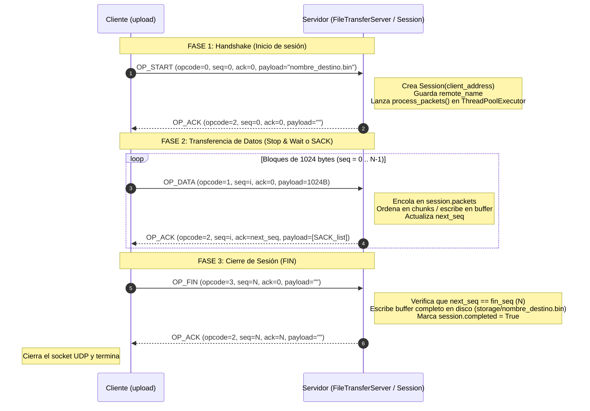

# Preguntas y Respuestas para la Defensa del TP1

Este documento responde en detalle las preguntas típicas de la defensa oral, basadas tanto en los conceptos teóricos de la materia como en **cómo está implementado exactamente nuestro código en `../TP1/src/lib/`**.

---

## 1. ¿Es necesario tener tanto `seq_num` como `ack_num` en el header de nuestro protocolo?

### Respuesta corta
**No es estrictamente necesario tener ambos en todos los paquetes** si la transferencia de datos es **unidireccional** (sin *piggybacking*), pero en nuestra implementación los incluimos en un header fijo de **11 bytes** (`opcode` 1B + `seq_num` 4B + `ack_num` 4B + `payload_len` 2B) por simplicidad de diseño y porque en **SACK** aprovechamos ambos campos en los paquetes `OP_ACK`.

### Explicación según nuestra implementación ([`protocol.py`](file:///home/rbarcala/MEGA/Redes/TP1/src/lib/protocol.py) y [`session.py`](file:///home/rbarcala/MEGA/Redes/TP1/src/lib/session.py))
- **En paquetes de datos (`OP_DATA`, `OP_START`, `OP_FIN`)**:
  - Como no hacemos *piggybacking* (el emisor solo envía datos y el receptor solo responde ACKs), el campo `ack_num` en un paquete `OP_DATA` es redundante (en `sack.py` se envía siempre en `0`). Solo se necesita `seq_num` para identificar qué bloque se está enviando.
- **En paquetes de confirmación (`OP_ACK`)**:
  - En **Stop & Wait** ([`stop_and_wait.py`](file:///home/rbarcala/MEGA/Redes/TP1/src/lib/stop_and_wait.py)): alcanza con un solo número (confirmar el paquete recibido).
  - En **Selective Repeat / SACK** ([`session.py`](file:///home/rbarcala/MEGA/Redes/TP1/src/lib/session.py#L37-L42) y [`sack.py`](file:///home/rbarcala/MEGA/Redes/TP1/src/lib/sack.py#L222-L224)): el receptor envía en el `OP_ACK`:
    - `seq_num`: el número de secuencia del paquete puntual que acaba de llegar y disparó este ACK.
    - `ack_num`: el **ACK acumulativo** (`expected_seq` / `self.next_seq`), es decir, el próximo número de secuencia en orden que el receptor está esperando (confirmando implícitamente todos los anteriores `< ack_num`).
    - `payload`: la lista de secuencias recibidas fuera de orden (bloques SACK de 4 bytes cada uno).
  - Incluso en SACK, al tener el ACK acumulativo + la lista SACK en el payload, un único campo de 4 bytes en el header alcanzaría si unificáramos el uso del campo entre `OP_DATA` (como `seq_num`) y `OP_ACK` (como `ack_num` acumulativo). Se dejaron ambos campos separados para tener una estructura de header simétrica similar a TCP.

---

## 2. ¿Qué representan los bytes del `seq_num` en UDP, en TCP y en nuestro protocolo?

1. **En UDP (capa de transporte)**:
   - **UDP NO tiene `seq_num`**. El header UDP solo tiene 8 bytes: Puerto Origen (2B), Puerto Destino (2B), Longitud (2B) y Checksum (2B). No garantiza entrega ni orden.
2. **En TCP (capa de transporte)**:
   - El `Sequence Number` de TCP (4 bytes / 32 bits) **cuenta bytes del flujo de datos**, no paquetes. Representa el **número de orden del primer byte de datos** contenido en ese segmento TCP (partiendo de un *Initial Sequence Number* aleatorio negociado en el *3-way handshake*).
   - De igual forma, el `ACK Number` en TCP indica el **próximo byte esperado** (es acumulativo).
3. **En nuestro protocolo sobre UDP ([`protocol.py`](file:///home/rbarcala/MEGA/Redes/TP1/src/lib/protocol.py))**:
   - Nuestro `seq_num` (4 bytes, `uint32` big-endian) **no cuenta bytes, sino número de paquete / bloque (*chunk*)**.
   - Arranca en `0` para el primer bloque de datos de `1024 bytes` (`CHUNK_SIZE = 1024`), `1` para el segundo bloque, y así sucesivamente hasta `N-1`, usando el número `N` para el paquete `OP_FIN`.

---

## 3. ¿Cómo implementamos el timeout?

Tenemos **dos mecanismos distintos** según el protocolo elegido:

### A. En Stop & Wait ([`transport.py`](file:///home/rbarcala/MEGA/Redes/TP1/src/lib/transport.py) y [`stop_and_wait.py`](file:///home/rbarcala/MEGA/Redes/TP1/src/lib/stop_and_wait.py))
- Se implementa directamente con el **timeout del socket UDP de Python**: `self.socket.settimeout(timeout)` (por defecto `1.0` segundo al crear [`FileTransferClient`](file:///home/rbarcala/MEGA/Redes/TP1/src/lib/file_transfer_client.py#L11), y `0.5s` en el cierre de `FIN`).
- En [`UdpTransport.try_receive()`](file:///home/rbarcala/MEGA/Redes/TP1/src/lib/transport.py#L23-L29), se hace `self.socket.recvfrom(buffer_size)` dentro de un bloque `try / except socket.timeout`:
  - Si el timer del socket expira antes de que llegue el datagrama, captura `socket.timeout` y devuelve `(None, None)`.
  - En `StopAndWait.send()`, si `transport.receive()` devuelve `None` o no es el ACK esperado, el bucle `for _ in range(MAX_TRIES)` (máximo 5 intentos) **retransmite el paquete**.

### B. En Selective Repeat / SACK ([`sack.py`](file:///home/rbarcala/MEGA/Redes/TP1/src/lib/sack.py))
Como hay hasta 32 paquetes en vuelo al mismo tiempo, no podemos bloquear el socket esperando un único paquete durante 1 segundo:
1. **Timers lógicos por paquete (`time_sent`)**:
   - Cuando se envía cada paquete en la ventana ([`sack.py`](file:///home/rbarcala/MEGA/Redes/TP1/src/lib/sack.py#L166-L171)), se guarda en el diccionario `packets[next_seq]` su timestamp de envío: `'time_sent': time.time()`, junto con `'sacked': False` y `'tries': 1`.
2. **Espera no bloqueante corta con `select.select` (`receive_acks`)**:
   - En [`SelectiveRepeat.receive_with_timeout()`](file:///home/rbarcala/MEGA/Redes/TP1/src/lib/sack.py#L41-L69), se usa `select.select([transport.socket], [], [], remaining)` con un `ACK_POLL_TIMEOUT = 0.02` (20 ms) para leer todos los ACKs que hayan llegado al buffer de red sin quedarse bloqueado si no llegan más.
3. **Verificación de RTO y retransmisión selectiva (`check_timeouts_and_retransmit`)**:
   - En cada iteración del bucle principal ([`sack.py`](file:///home/rbarcala/MEGA/Redes/TP1/src/lib/sack.py#L101-L118)), se recorren los paquetes pendientes en `packets`.
   - Para cada paquete con `sacked == False`, se calcula `time_since_sent = current_time - packet_info['time_sent']`.
   - Si `time_since_sent >= RTO` (`INITIAL_RTO = 0.5` segundos) y `tries < MAX_TRIES` (12 intentos), **se retransmite únicamente ese paquete**, se actualiza su `time_sent = current_time` y se incrementa `tries += 1`.

### C. En las sesiones del Servidor para Uploads ([`session.py`](file:///home/rbarcala/MEGA/Redes/TP1/src/lib/session.py))
- El hilo principal del servidor recibe todos los datagramas y los encola en `session.packets` (una `queue.Queue` por cliente).
- El worker thread de la sesión hace `self.packets.get(timeout=TIMEOUT)` con `TIMEOUT = 5` segundos ([`session.py`](file:///home/rbarcala/MEGA/Redes/TP1/src/lib/session.py#L66)). Si un cliente desaparece por más de 5 segundos, salta la excepción `Empty` y la sesión se aborta y limpia.

---

## 4. ¿Cómo funciona la ventana de SACK (Selective Repeat)?

Está implementada en [`src/lib/sack.py`](file:///home/rbarcala/MEGA/Redes/TP1/src/lib/sack.py) (emisor y receptor de download) y [`src/lib/session.py`](file:///home/rbarcala/MEGA/Redes/TP1/src/lib/session.py) (receptor de upload en el servidor):

### Lado Emisor (`SelectiveRepeat.send`)
- **Tamaño de ventana**: `WINDOW_SIZE = 32` paquetes (cada paquete lleva hasta `CHUNK_SIZE = 1024` bytes $\rightarrow$ hasta 32 KB en vuelo).
- **Punteros de la ventana**:
  - `base_seq`: el número de secuencia más viejo que **todavía no fue confirmado**.
  - `next_seq`: el próximo número de secuencia a enviar.
- **Condición de envío**: mientras no se llegue al fin del archivo (`not eof`) y **`next_seq < base_seq + WINDOW_SIZE`**, el emisor lee bloques del archivo, los envía sin esperar y los registra en el diccionario `packets[next_seq]`.
- **Procesamiento de ACKs (`receive_acks`)**:
  - Cada paquete `OP_ACK` que vuelve del receptor trae dos informaciones clave:
    1. **`ack_packet.ack_num` (ACK acumulativo)**: indica que el receptor ya recibió en forma continua todos los paquetes anteriores a `ack_num`. Por lo tanto, el emisor **elimina de `packets` todos los `seq_num < cumulative_ack`** y desliza la base de la ventana: `base_seq = max(base_seq, cumulative_ack)`. Al avanzar `base_seq`, se habilita espacio para enviar nuevos paquetes.
    2. **`ack_packet.payload` (Lista SACK)**: es una secuencia de enteros de 4 bytes (`_decode_sack`) con los números de secuencia mayores a `base_seq` que el receptor ya recibió fuera de orden. El emisor marca esos paquetes en su diccionario con **`packets[seq_num]['sacked'] = True`**.
- **Retransmisión selectiva**:
  - Cuando vence el `RTO` (`0.5s`), `check_timeouts_and_retransmit` **ignora los paquetes que tienen `'sacked': True`** y solo retransmite aquellos paquetes dentro de la ventana cuyo timer venció y siguen sin confirmarse.

### Lado Receptor (`Session.update_session` y `SelectiveRepeat.receive`)
- Mantiene:
  - `expected_seq` (o `self.next_seq`): el próximo paquete esperado en orden.
  - `chunks`: un diccionario (`{seq_num: payload}`) que actúa como **buffer de recepción fuera de orden**.
- Cuando llega un `OP_DATA` con `packet.seq_num`:
  1. **Si `seq_num < expected_seq`**: es un duplicado viejo. No lo guarda, pero reenvía inmediatamente un `OP_ACK` con el `expected_seq` actual y la lista SACK actual.
  2. **Si `seq_num > expected_seq`**: llegó fuera de orden (se perdió alguno anterior). Lo guarda en el buffer `chunks[seq_num] = payload` (si no estaba ya) y envía un `OP_ACK` indicando que sigue esperando `expected_seq`, pero adjuntando en el payload todas las claves `sorted(chunks.keys())` codificadas en 4 bytes cada una (el bloque SACK).
  3. **Si `seq_num == expected_seq`**: era el paquete que faltaba para mantener el orden. Lo escribe en el archivo/buffer, incrementa `expected_seq += 1`, y ejecuta un bucle `while expected_seq in chunks:` que **vuelca en orden todos los paquetes consecutivos que ya habían llegado antes por SACK**, vaciándolos de `chunks` y deslizando `expected_seq` de golpe.

---

## 5. Uso de `ifconfig` / `ip -s link` antes y después de enviar un archivo

### ¿Por qué el docente pide correr `ifconfig` (o `ip -s link`) antes y después de la transferencia?
Para medir **a nivel de interfaz de red del sistema operativo** cuántos paquetes (`packets`) y cuántos bytes (`bytes`) se transmitieron (`TX`) y recibieron (`RX`) realmente por el cable virtual de Mininet (`h1-eth0`).

### ¿Cómo se lee `ifconfig` (o `ip -s link`) y qué se compara?
Si en la `xterm` de `h1` ejecutás `ifconfig` (o `ip -s link show h1-eth0`) antes y después de subir un archivo de **5 MB** ($5 \times 1024 \times 1024 = 5.242.880\text{ bytes}$):
1. **Cantidad de paquetes de datos ideales (sin pérdida)**:
   $$\frac{5.242.880\text{ bytes}}{1024\text{ bytes/paquete}} = 5120\text{ paquetes de datos} + 1\text{ START} + 1\text{ FIN} = 5122\text{ paquetes}$$
2. **Estimación teórica con 10% de pérdida en cada sentido ($p = 0.10$)**:
   - Como el enlace de ida pierde el 10% de los paquetes, cada paquete de datos necesita en promedio $\frac{1}{1 - p} = \frac{1}{0.9} \approx 1.111$ envíos.
   - Es decir, como mínimo esperamos transmitir por `TX`:
     $$\frac{5120}{0.90} \approx 5689\text{ paquetes de datos}$$
     lo que equivale a **~569 retransmisiones** como piso (más algunas retransmisiones extra cuando se pierden los ACKs en el sentido de vuelta con otro 10% de probabilidad y vencen los RTOs).
3. **Comparación con `TX packets` y `TX bytes` de `ifconfig` / `ip -s link`**:
   - Restás `TX packets (después) - TX packets (antes)`. Vas a ver un valor cercano a `~5750 - 6100` paquetes.
   - Restando los `5122` paquetes originales obtenés la cantidad de paquetes retransmitidos, y demostrás que es consistente con el 10% de pérdida configurado en Mininet.
   - En `TX bytes (después) - TX bytes (antes)` vas a ver que en lugar de enviarse solo `5.24 MB`, se enviaron alrededor de `~6.0 - 6.3 MB` por la red debido a:
     1. Los bytes de los paquetes retransmitidos (~10-15% extra).
     2. El overhead de encabezados de cada paquete: `14B (Ethernet) + 20B (IP) + 8B (UDP) + 11B (Protocolo TP1) = 53 bytes` de headers por cada paquete de `1024 bytes` de datos.

*(Nota: en nuestro script [`04_transferencia_pipelining.sh`](file:///home/rbarcala/MEGA/Redes/scripts_TP1/04_transferencia_pipelining.sh) ya se imprime la salida de `ip -s link` antes y después y se hace esta resta automáticamente, pero también podés tirar `ifconfig` a mano en la `xterm` si el profe te lo pide).*

---

## 6. ¿Cómo es el ciclo completo de paquetes de un `UPLOAD` de Cliente a Servidor?

El ciclo completo tiene **3 fases** y se puede seguir en [`src/upload`](file:///home/rbarcala/MEGA/Redes/TP1/src/upload), [`file_transfer_client.py`](file:///home/rbarcala/MEGA/Redes/TP1/src/lib/file_transfer_client.py), [`file_transfer_server.py`](file:///home/rbarcala/MEGA/Redes/TP1/src/lib/file_transfer_server.py) y [`session.py`](file:///home/rbarcala/MEGA/Redes/TP1/src/lib/session.py):

### Paso a paso detallado en el código:

1. **Fase 1 — Handshake (`OP_START`)**:
   - En [`src/upload`](file:///home/rbarcala/MEGA/Redes/TP1/src/upload#L53), el cliente llama a `cliente.connect(args.name)`.
   - `connect()` ([`file_transfer_client.py`](file:///home/rbarcala/MEGA/Redes/TP1/src/lib/file_transfer_client.py#L16-L60)) arma un paquete `OP_START` (`opcode = 0`, `seq = 0`, `ack = 0`) cuyo `payload` es el nombre con el que se guardará el archivo en el servidor (ej. `"destino.bin"`), y lo envía al puerto `5005` del servidor esperando el `OP_ACK` (reintentando hasta `MAX_TRIES` si se pierde).
   - El servidor lo recibe en su hilo principal (`serve_forever` $\rightarrow$ `handle_packet`), ve que es un `OP_START`, instancia un objeto [`Session`](file:///home/rbarcala/MEGA/Redes/TP1/src/lib/session.py) asociado a la tupla `(ip_cliente, puerto_efimero_cliente)`, guarda `client_session.remote_name = file_name`, responde inmediatamente el `OP_ACK` (`seq = 0, ack = 0`) en `start_session()`, y envía la tarea `client_session.process_packets` al `ThreadPoolExecutor(max_workers=10)`.

2. **Fase 2 — Envío de datos (`OP_DATA` $\leftrightarrow$ `OP_ACK`)**:
   - Una vez confirmado el handshake, [`src/upload`](file:///home/rbarcala/MEGA/Redes/TP1/src/upload#L56) llama a `cliente.upload(args.src, args.name, args.protocol)`.
   - Dependiendo de `-r sw` o `-r sack`, delega en `StopAndWait.send()` o `SelectiveRepeat.send()` usando **el mismo socket UDP** del cliente.
   - El cliente abre el archivo local en modo binario (`"rb"`), lo lee en fragmentos de `1024 bytes` (`CHUNK_SIZE`), y envía paquetes `OP_DATA` (`opcode = 1`) numerados desde `seq_num = 0` hasta `N - 1`.
   - En el servidor, cada vez que llega un paquete de ese `(ip_cliente, puerto_cliente)`, el hilo principal lo mete en la cola `self.sessions[client_address].enqueue(packet)`.
   - El hilo trabajador de esa `Session` lo saca de la cola en `process_packets()` $\rightarrow$ `update_session()`, guarda el fragmento en `self.chunks[seq_num]`, ensambla en orden en `self.buffer` a medida que `self.next_seq` está disponible, y envía de vuelta un `OP_ACK` (`opcode = 2`) con `seq = packet.seq_num`, `ack = self.next_seq` y la lista SACK de bloques fuera de orden en el payload.

3. **Fase 3 — Fin de transferencia (`OP_FIN` $\leftrightarrow$ `OP_ACK`)**:
   - Cuando el cliente termina de leer el archivo (y, en el caso de SACK, cuando todos los paquetes de datos en la ventana fueron confirmados y `packets` quedó vacío), envía un paquete `OP_FIN` (`opcode = 3`) con `seq_num = N` (donde `N` es la cantidad total de bloques de datos enviados) y payload vacío.
   - Si el `OP_FIN` o su `OP_ACK` se pierden, el cliente reintenta enviar el `OP_FIN` hasta `MAX_TRIES`.
   - Cuando la `Session` del servidor recibe el `OP_FIN` (y ya tiene todos los bloques desde `0` hasta `N - 1`, es decir `self.next_seq == self.fin_seq`), responde el `OP_ACK` del `FIN` y llama a [`complete_transfer()`](file:///home/rbarcala/MEGA/Redes/TP1/src/lib/session.py#L124-L140), que vuelca `self.buffer` al archivo final en disco (`storage/<remote_name>`) y marca `self.completed = True`, terminando el hilo de esa sesión.
   - El cliente recibe el `OP_ACK` del `OP_FIN`, ejecuta el bloque `finally: cliente.close()` cerrando el socket UDP y finaliza el programa.

*(Nota adicional por si te preguntan la diferencia con **DOWNLOAD**: en un `UPLOAD` todos los paquetes viajan por el puerto `5005` del servidor encolados en `Session.packets`, mientras que en un `DOWNLOAD` el cliente envía `OP_START` con payload `"DOWNLOAD:sack:archivo.bin"` al puerto `5005` y el servidor lanza `_worker_task` en el `ThreadPoolExecutor` creando un `sender_transport = UdpTransport()` nuevo con su propio socket efímero para transmitirle los `OP_DATA` al cliente sin competir por lecturas del socket `5005`).*

